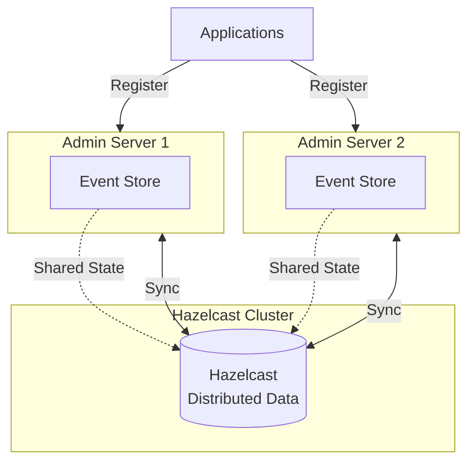

# Hazelcast Clustering

Hazelcast provides distributed data structures for clustering multiple Spring Boot Admin Server instances. This enables
high availability and shared state across servers.

## Overview

With Hazelcast clustering:

- Multiple Admin Server instances share event store
- No single point of failure
- Automatic synchronization across nodes
- Distributed notifications

## Architecture



## Why Hazelcast?

- **High Availability**: No single point of failure
- **Scalability**: Add more Admin Server instances
- **Shared State**: All servers see the same application state
- **Distributed Events**: Events propagated across cluster
- **Simple Setup**: Minimal configuration required

## Setting Up Hazelcast

### Add Dependencies

```xml title="pom.xml"
<dependencies>
    <dependency>
        <groupId>de.codecentric</groupId>
        <artifactId>spring-boot-admin-starter-server</artifactId>
    </dependency>
    <dependency>
        <groupId>org.springframework.boot</groupId>
        <artifactId>spring-boot-starter-webflux</artifactId>
    </dependency>
    <dependency>
        <groupId>org.springframework.boot</groupId>
        <artifactId>spring-boot-starter-hazelcast</artifactId>
    </dependency>
    <dependency>
        <groupId>com.hazelcast</groupId>
        <artifactId>hazelcast</artifactId>
    </dependency>
</dependencies>
```

`spring-boot-starter-hazelcast` is declared as an optional dependency of `spring-boot-admin-server`, so it is not
pulled in transitively by `spring-boot-admin-starter-server`. Without it, Spring Boot does not auto-configure a
`HazelcastInstance` and the Admin Server nodes do not form a cluster.

### Configure Hazelcast

```java title="HazelcastConfig.java"
import com.hazelcast.config.Config;
import com.hazelcast.config.EvictionConfig;
import com.hazelcast.config.EvictionPolicy;
import com.hazelcast.config.InMemoryFormat;
import com.hazelcast.config.MapConfig;
import com.hazelcast.config.MergePolicyConfig;
import com.hazelcast.config.MaxSizePolicy;
import com.hazelcast.spi.merge.PutIfAbsentMergePolicy;
import org.springframework.context.annotation.Bean;
import org.springframework.context.annotation.Configuration;

@Configuration
public class HazelcastConfig {

    @Bean
    public Config hazelcastConfig() {
        MapConfig eventStoreMap = new MapConfig("spring-boot-admin-event-store")
            .setInMemoryFormat(InMemoryFormat.OBJECT)
            .setBackupCount(1)
            .setMergePolicyConfig(new MergePolicyConfig(
                PutIfAbsentMergePolicy.class.getName(), 100));

        MapConfig sentNotificationsMap = new MapConfig("spring-boot-admin-sent-notifications")
            .setInMemoryFormat(InMemoryFormat.OBJECT)
            .setBackupCount(1)
            .setEvictionConfig(new EvictionConfig()
                .setEvictionPolicy(EvictionPolicy.LRU)
                .setMaxSizePolicy(MaxSizePolicy.PER_NODE))
            .setMergePolicyConfig(new MergePolicyConfig(
                PutIfAbsentMergePolicy.class.getName(), 100));

        MapConfig notificationFiltersMap = new MapConfig("spring-boot-admin-notification-filters")
            .setInMemoryFormat(InMemoryFormat.OBJECT)
            .setBackupCount(1)
            .setMergePolicyConfig(new MergePolicyConfig(
                PutIfAbsentMergePolicy.class.getName(), 100));

        Config config = new Config();
        config.addMapConfig(eventStoreMap);
        config.addMapConfig(sentNotificationsMap);
        config.addMapConfig(notificationFiltersMap);
        config.setProperty("hazelcast.jmx", "true");

        // Development example: use multicast for cluster discovery.
        config.getNetworkConfig()
            .getJoin()
            .getMulticastConfig()
            .setEnabled(true);

        return config;
    }
}
```

The Hazelcast starter uses this `Config` bean to create the `HazelcastInstance`. Do not create a `HazelcastInstance` or
an `InstanceEventStore` bean for the standard setup; Spring Boot Admin configures those automatically.

To load an external Hazelcast XML or YAML file instead, point Spring Boot at it with `spring.hazelcast.config`:

```yaml title="application.yml"
spring:
  hazelcast:
    config: classpath:hazelcast.yaml
```

The referenced file must use Hazelcast's configuration format. Hazelcast settings placed directly under `hazelcast.*` in
Spring Boot's `application.yml` are not bound as Spring Boot application properties.

### Basic Configuration

The `Config` bean above uses Hazelcast's default multicast discovery. For a different discovery mechanism, configure the
Hazelcast `Config` bean or use an external Hazelcast configuration file via `spring.hazelcast.config`.

### Selective Clustering

The event store, sent-notifications map, and notification-filters map can be disabled
independently. All three maps are enabled by default:

```yaml title="application.yml"
spring:
  boot:
    admin:
      hazelcast:
        event-store-enabled: false
        sent-notifications-enabled: true
        notification-filters-enabled: false
```

When the event-store map is disabled, Spring Boot Admin uses its in-memory event store
and still applies `spring.boot.admin.event-store.max-log-size-per-aggregate` and
`spring.boot.admin.event-store.prune-info-updated-events`.

When the sent-notifications map is disabled, notifications are not deduplicated across the cluster, so every node
sends its own notifications. When the notification-filters map is disabled, the `notificationFiltersMap` bean is a
local map, and filters are not shared. All switches are evaluated at runtime and work with AOT.

These switches apply to Spring Boot Admin's auto-configured beans. If you declare your own `InstanceEventStore` bean,
it replaces the auto-configured event store, so `event-store-enabled` no longer selects between the Hazelcast and
in-memory stores. A `Config` bean alone does not disable these switches.

## Network Configuration

### Multicast (Development)

Automatic discovery using multicast:

```java
config.getNetworkConfig()
    .getJoin()
    .getMulticastConfig()
    .setEnabled(true)
    .setMulticastGroup("224.2.2.3")
    .setMulticastPort(54327);
```

For a Hazelcast YAML configuration file, set the equivalent Hazelcast `network.join.multicast` options in that file and
load it with `spring.hazelcast.config` as shown above.

### TCP/IP (Production)

Explicit member list for production:

```java
config.getNetworkConfig()
    .getJoin()
    .getMulticastConfig()
    .setEnabled(false);

config.getNetworkConfig()
    .getJoin()
    .getTcpIpConfig()
    .setEnabled(true)
    .addMember("192.168.1.100")
    .addMember("192.168.1.101")
    .addMember("192.168.1.102");
```

For a Hazelcast YAML configuration file, put the member list under Hazelcast's `network.join.tcp-ip` configuration and
load the file with `spring.hazelcast.config` as shown above.

### Kubernetes

For Kubernetes deployments:

```xml
<dependency>
    <groupId>com.hazelcast</groupId>
    <artifactId>hazelcast-kubernetes</artifactId>
</dependency>
```

```java
config.getNetworkConfig()
    .getJoin()
    .getMulticastConfig()
    .setEnabled(false);

config.getNetworkConfig()
    .getJoin()
    .getKubernetesConfig()
    .setEnabled(true)
    .setProperty("namespace", "default")
    .setProperty("service-name", "spring-boot-admin");
```

## Event Store Configuration

### Map Configuration

```java
MapConfig mapConfig = new MapConfig("spring-boot-admin-event-store")
    .setBackupCount(1)  // Number of backup copies
    .setAsyncBackupCount(0)  // Async backups
    .setTimeToLiveSeconds(0)  // No expiration
    .setMaxIdleSeconds(0)  // No idle timeout
    .setMergePolicyConfig(new MergePolicyConfig(
        PutIfAbsentMergePolicy.class.getName(), 100));
```

### Event Store Size

Limit events per instance:

```yaml title="application.yml"
spring:
  boot:
    admin:
      event-store:
        max-log-size-per-aggregate: 500
```

This setting applies to the auto-configured Hazelcast and in-memory event stores. A custom `InstanceEventStore` bean
must apply its own retention limit.

## High Availability Setup

### Load Balancer Configuration

```nginx
upstream spring_boot_admin {
    least_conn;
    server admin1:8080;
    server admin2:8080;
    server admin3:8080;
}

server {
    listen 80;
    server_name admin.example.com;

    location / {
        proxy_pass http://spring_boot_admin;
        proxy_set_header Host $host;
        proxy_set_header X-Real-IP $remote_addr;
        proxy_set_header X-Forwarded-For $proxy_add_x_forwarded_for;
        proxy_set_header X-Forwarded-Proto $scheme;
    }
}
```

### Session Persistence

Use sticky sessions for the UI:

```nginx
upstream spring_boot_admin {
    ip_hash;  # Sticky sessions
    server admin1:8080;
    server admin2:8080;
}
```

Or use Spring Session:

```xml
<dependency>
    <groupId>org.springframework.session</groupId>
    <artifactId>spring-session-hazelcast</artifactId>
</dependency>
```

```java
@EnableHazelcastHttpSession
@Configuration
public class SessionConfig {
    // Hazelcast will be used for session storage
}
```

## Docker Compose Example

```yaml title="docker-compose.yml"
version: '3'

services:
  admin1:
    build: ./admin-server
    ports:
      - "8080:8080"
    environment:
      - SERVER_PORT=8080

  admin2:
    build: ./admin-server
    ports:
      - "8081:8080"
    environment:
      - SERVER_PORT=8080

  admin3:
    build: ./admin-server
    ports:
      - "8082:8080"
    environment:
      - SERVER_PORT=8080

  nginx:
    image: nginx:alpine
    ports:
      - "80:80"
    volumes:
      - ./nginx.conf:/etc/nginx/nginx.conf
    depends_on:
      - admin1
      - admin2
      - admin3
```

This Compose snippet only starts the services; it does not configure Hazelcast discovery. `HAZELCAST_MEMBERS` is not
read by Spring Boot Admin or Hazelcast by default. Configure discovery in the Hazelcast `Config` bean or an external
Hazelcast configuration file, and make that configuration available to every container. Member addresses must be
reachable on the Compose network.

## Monitoring Hazelcast

### Management Center

Use Hazelcast Management Center:

Configure and connect Management Center using Hazelcast's own settings for the version in use; the
`hazelcast.management-center.*` keys are not Spring Boot properties.

### JMX Monitoring

Enable JMX:

```java
config.setProperty("hazelcast.jmx", "true");
```

### Health Checks

Check cluster health:

```java
@Component
public class HazelcastHealthCheck {

    private final HazelcastInstance hazelcastInstance;

    public HazelcastHealthCheck(HazelcastInstance hazelcastInstance) {
        this.hazelcastInstance = hazelcastInstance;
    }

    public boolean isHealthy() {
        return hazelcastInstance.getCluster().getMembers().size() > 0;
    }

    public int getClusterSize() {
        return hazelcastInstance.getCluster().getMembers().size();
    }
}
```

## Troubleshooting

### Split Brain

Configure merge policy:

```java
mapConfig.setMergePolicyConfig(new MergePolicyConfig(
    PutIfAbsentMergePolicy.class.getName(), 100));
```

### Members Not Joining

1. **Check network connectivity**:
   ```bash
   telnet admin1 5701
   ```

2. **Verify multicast**:
   ```bash
   # Check if multicast is enabled
   ip maddr show
   ```

3. **Check logs**:
   ```
   Hazelcast logs will show connection attempts
   ```

### Performance Issues

1. **Increase backup count**:
   ```java
   mapConfig.setBackupCount(2);
   ```

2. **Use async backups**:
   ```java
   mapConfig.setAsyncBackupCount(1);
   ```

3. **Monitor map size**:
   ```java
   IMap map = hazelcastInstance.getMap("spring-boot-admin-event-store");
   log.info("Map size: {}", map.size());
   ```

## Best Practices

1. **Use TCP/IP in Production**: Multicast may not work in cloud environments

2. **Configure Appropriate Backups**:
   ```java
   mapConfig.setBackupCount(1);  // At least 1 backup
   ```

3. **Set Event Store Limits**:
   ```java
   new HazelcastEventStore(500, map);  // Reasonable limit
   ```

4. **Monitor Cluster Health**: Use Management Center or JMX

5. **Use Load Balancer**: Distribute traffic across servers

6. **Enable Session Persistence**: For seamless failover

7. **Configure Network Properly**: Especially in Kubernetes/Docker

## Complete Example

See
the [spring-boot-admin-sample-hazelcast](https://github.com/codecentric/spring-boot-admin/tree/master/spring-boot-admin-samples/spring-boot-admin-sample-hazelcast/)
project for a complete working example.

## See Also

- [Clustering](../02-server/20-Clustering.mdx) - Clustering overview
- [Persistence](../02-server/30-persistence.md) - Event store details
- [Hazelcast Sample](../09-samples/60-sample-hazelcast.md) - Detailed sample walkthrough
